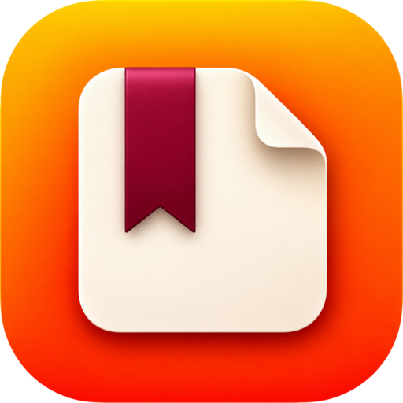

<p align="center">
  
</p>

<h1 align="center">Cinta</h1>

<p align="center"><strong>Tu biblioteca personal, táctil y sin nube.</strong></p>

<p align="center">Un lector de libros para Windows y Linux que se queda en tu equipo.<br>
Sin cuentas, sin sincronización y sin telemetría.</p>

---

Hola. Cinta nació de una idea muy simple: quería abrir mis libros en la computadora y sentir que estaba abriendo un libro, no entrando a una plataforma.

Quería mis archivos donde yo los dejara, mis notas a mano y que la app no me pidiera una cuenta para leer algo que ya era mío. Así que la construí desde cero, con calma, cuidando los detalles pequeños: cómo se pasa la página, cómo se ve una nota al margen, qué tan grande tiene que ser un botón para no fallar con el dedo.

Cinta no tiene servidores. Todo ocurre en tu computadora: los libros, las notas, los resaltados y el progreso. Si algún día borras la app, tus archivos siguen ahí.

Esto es lo que hay hoy.

## Descargar

Elige el archivo que corresponda a tu equipo. Todos salen de la [única versión publicada: la 0.7.2](https://github.com/IsHyperactive/cinta/releases/latest).

| Plataforma | Descarga |
| :--- | :--- |
| **Windows x64** (Intel/AMD) | [Cinta-portable-x64.exe](https://github.com/IsHyperactive/cinta/releases/latest/download/Cinta-portable-x64.exe) |
| **Windows ARM64** | [Cinta-portable-ARM64.exe](https://github.com/IsHyperactive/cinta/releases/latest/download/Cinta-portable-ARM64.exe) |
| **Linux x64** | [.deb](https://github.com/IsHyperactive/cinta/releases/latest/download/Cinta-linux-x64.deb) · [.rpm](https://github.com/IsHyperactive/cinta/releases/latest/download/Cinta-linux-x64.rpm) · [AppImage](https://github.com/IsHyperactive/cinta/releases/latest/download/Cinta-linux-x64.AppImage) |
| **Linux ARM64** | [.deb](https://github.com/IsHyperactive/cinta/releases/latest/download/Cinta-linux-arm64.deb) · [.rpm](https://github.com/IsHyperactive/cinta/releases/latest/download/Cinta-linux-arm64.rpm) · [AppImage](https://github.com/IsHyperactive/cinta/releases/latest/download/Cinta-linux-arm64.AppImage) |

### ¿Cuál me conviene?

- **Windows:** Cinta es portable. Descarga el `.exe` de tu arquitectura, guárdalo donde quieras y ábrelo. No se instala: la biblioteca queda en `CintaData`, junto al `.exe`, así que puedes llevarla en un USB. En Windows 11 ya viene WebView2; si falta, Windows lo descarga al abrir la app.
- **Linux:** usa el `.deb` si estás en Debian o Ubuntu, el `.rpm` si estás en Fedora u openSUSE, y el AppImage si prefieres no instalar nada. Le das permiso de ejecución (`chmod +x`) y lo abres.

En Linux hace falta WebKitGTK 4.1 (`libwebkit2gtk-4.1-0` en Debian/Ubuntu).

```bash
chmod +x Cinta-linux-x64.AppImage
./Cinta-linux-x64.AppImage

# O, en Debian/Ubuntu:
sudo apt install ./Cinta-linux-x64.deb
```

## La única versión publicada: 0.7.2

La **0.7.2** sustituye a la **0.7.0** y a la **0.7.1**, que quedaron descontinuadas por sus fallos y ya no se publican. Esta es la versión que hay que descargar.

- **El Desenfoque del fondo ya funciona de verdad.** El deslizador difumina la propia imagen del fondo (antes solo difuminaba el cristal de los paneles) y sigue actuando al mover la atenuación. La etiqueta ahora dice «Desenfoque de la imagen».
- **La entrega sigue en 9 archivos exactos:** `Cinta-portable-x64.exe`, `Cinta-portable-ARM64.exe`, `.deb`, `.rpm` y AppImage para Linux x64 y ARM64, más `SHA256SUMS.txt`. Sin instaladores ni formatos extra.
- **Se mantiene todo lo bueno de la 0.7.1:** no hay animación «Hoja de libro» (se retiró porque no igualaba el pase de página de Apple Books) y la guía incluida conserva la lista «Qué encontrarás» en una sola página.
- **Se mantiene todo lo bueno de la 0.7.0:** libro a doble página con el lomo en el centro, fuentes a la vista en el panel «Aa» y marcapáginas vectoriales (SVG), más grandes y con recortes nítidos.

### Por qué ya no están la 0.7.0 y la 0.7.1

- La **0.7.0** traía la animación «Hoja de libro», pero la hoja era rígida, giraba plana, se salía del borde y mostraba un reverso gris: no estaba a la altura. Además, el deslizador de desenfoque no difuminaba la imagen.
- La **0.7.1** quitó esa animación y arregló la guía, pero seguía arrastrando el fallo del desenfoque: el control solo afectaba a los paneles y parecía dejar de funcionar con la atenuación alta.
- La **0.7.2** reúne lo bueno de ambas y corrige el desenfoque. Por eso sus releases y etiquetas anteriores se eliminaron: **la única versión publicada es la 0.7.2**.

## Antes, en la 0.6.2

Esta versión arregla la búsqueda y deja la entrega en 9 archivos: Windows portable y tres formatos de Linux por arquitectura.

- **La búsqueda ya no se aplasta.** Conserva su ancho (hasta 390 px) y, si los controles no caben, la barra superior los pasa a otra fila. La barra lateral se queda a la izquierda en todas las ventanas de escritorio.
- **Volvieron los portables.** Cada release publica siempre los mismos 9 archivos: `Cinta-portable-x64.exe` y `Cinta-portable-ARM64.exe`; `.deb`, `.rpm` y AppImage para Linux x64 y ARM64; y `SHA256SUMS.txt`. En Windows no hay instaladores: Cinta es portable.
- Si vienes de la 0.6.1, esta versión también incluye los **temas de color** y el **fondo personalizado**.

Y si vienes de más atrás, la 0.6.0 trajo las **series**, el **tiempo de lectura**, la **voz** en EPUB, el **desplazamiento continuo**, el **ancho del texto** y los botones de **copiar cita** y **buscar** al seleccionar.

## Lo que puedes hacer

**Ordenar tu biblioteca**

- Importa libros con el botón, arrastrándolos a la ventana o pasando una carpeta completa.
- Crea colecciones, agrupa en series, busca por título, autor o serie y cambia entre cuadrícula y lista.
- Cinta guarda una copia de cada libro en su carpeta de datos. Tu archivo original no se toca.

**Leer**

- **EPUB:** paginación o desplazamiento continuo, índice, búsqueda, temas, tipografías, ancho del texto, lectura en voz alta, gestos táctiles y progreso guardado.
- **PDF:** desplazamiento continuo, zoom, miniaturas, índice, búsqueda y modo noche.
- **Cómics CBZ/CBR:** lector de páginas con ajuste de imagen y modo manga.
- **Documentos:** TXT, HTML, DOCX, FB2, MOBI y AZW3 convertidos para leer dentro de la app.
- **Audiolibros:** M4B, M4A y MP3 con velocidad, temporizador, marcadores y controles multimedia.

**Anotar**

- Marcadores, resaltados en cuatro colores y notas de texto.
- Trazos a mano con lápiz o stylus.
- Todo queda asociado al libro y vuelve contigo cuando lo abres de nuevo.

**Usarla con el dedo**

- Botones grandes, gestos y menús pensados para pantalla táctil.
- Se adapta a horizontal, vertical y ventanas estrechas.
- Tema claro u oscuro según el sistema.

## Empezar sin manual

Cinta incluye su propia **Guía de Cinta** como libro de bienvenida, dentro del ejecutable. La primera vez que la abres, ya está en tu biblioteca.

## Cómo está hecha

Cinta es una app de escritorio hecha con **Tauri 2**, **React** y **Rust**. La interfaz está en español y el código también se lee en español. Es software libre con licencia MIT; puedes mirar cómo funciona, cambiarlo o usarlo de base para lo tuyo.

## Privacidad

No hay servidores, ni cuentas, ni inicio de sesión, ni telemetría, ni conexiones en segundo plano para «mejorar el servicio».

- Solo trabaja con archivos de tu equipo.
- Si añades un libro, guarda una copia en su carpeta de datos; el original sigue donde estaba.
- Si eliminas un libro de la biblioteca, borra su copia, nunca tu archivo.
- También puedes abrir un archivo sin añadirlo a la biblioteca.

## Contribuir

Si encuentras un fallo, tienes una idea o quieres probarla en otro equipo, me viene muy bien. Empieza por [CONTRIBUTING.md](.github/CONTRIBUTING.md) o abre un [issue](https://github.com/IsHyperactive/cinta/issues).

## Licencia

[MIT](LICENSE). Hazlo tuyo.

---

**¿Necesitas ayuda?** Abre la **Guía de Cinta** dentro de la aplicación o pásate por [github.com/IsHyperactive/cinta](https://github.com/IsHyperactive/cinta).
